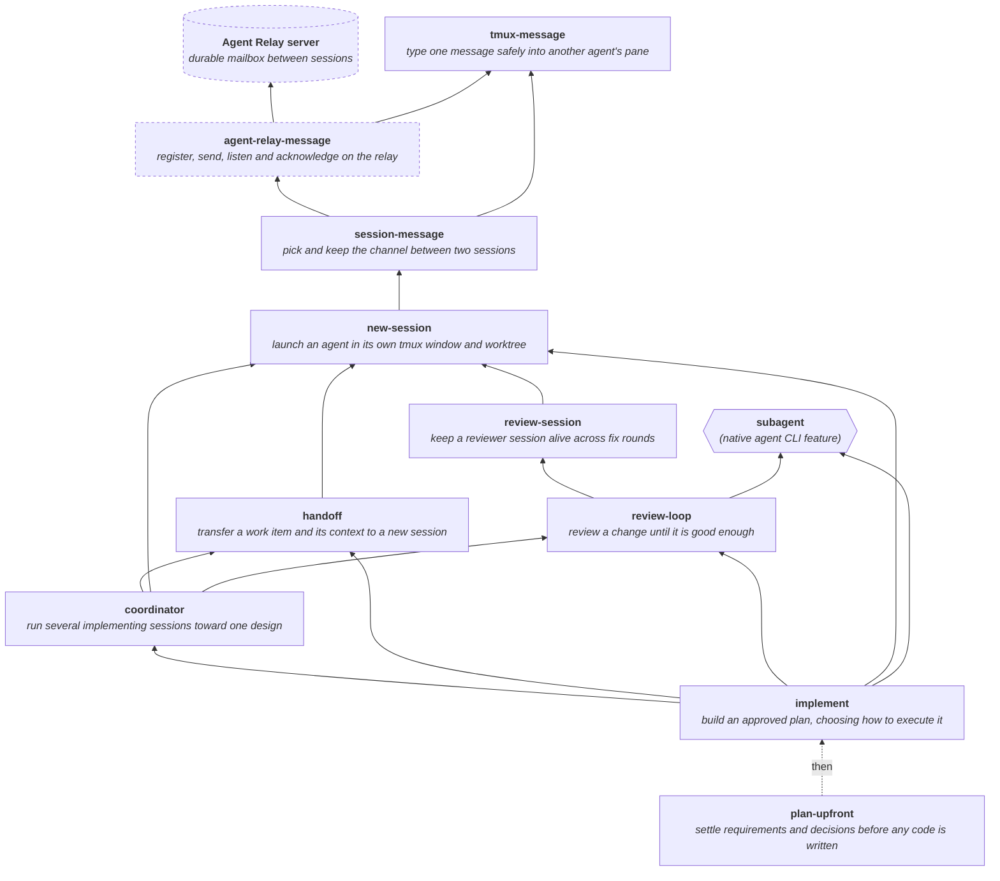

# agent-skills

My personal collection of skills for coding agents. Each one teaches an agent
CLI such as Claude Code or Codex CLI how to do one recurring job the way I
want it done. Some skills are checklists, some are workflows, and some ship a
script that does the job. They are written for my own setup, but none depends
on it.

The skills are modular: each does one job and names the skills it builds on,
so you can take the base skills without the workflows built on them. If
`implement`'s flow is too specific for you, `session-message` still gives your
own sessions a reliable channel, and `new-session` still launches them; if
you only want to type into another agent's pane safely, `tmux-message` works
alone.

## How the session skills fit together

Most of these skills are about splitting work across agent sessions and
keeping those sessions in touch. Base skills are at the top, and each arrow
points from a skill to one it calls directly. Every skill that launches or
messages a session also uses `session-message` directly; of those arrows only
`new-session`'s is drawn. The dotted arrow is not a call: you usually write a
plan with `plan-upfront`, then build it with `implement`. `coordinator` also
writes any new design it needs mid-workstream with `plan-upfront`. Every skill
can also be run on its own.

The dashed nodes live in the
[agent-relay](https://github.com/bellatechnica/agent-relay) repository. The
hexagon is not a skill: it is the agent CLI's own subagent, which `implement`
can build a piece in and `review-loop` can review with. Some
skills also follow rules defined by a skill drawn below them, one that uses
them; those back-references are not drawn: `coordinator` and `review-loop` follow
`implement`'s escalation and landing rules, `review-session` judges its stop
level as `review-loop` does, and `agent-relay-message` sends its wake notices
through `session-message`'s delivery script.

## What's here

**Messaging between sessions**

- `tmux-message` — send one message into another agent's tmux pane. The sender
  refuses to type over a draft, a dialog or an unrecognised layout, and checks
  that the message was actually submitted.
- `session-message` — choose and maintain the message channel between agent
  sessions: Agent Relay by default, or direct messaging (guarded tmux first,
  the recipient's native client as fallback) when asked for or as an announced
  fallback when Relay's check fails.

**Launching and handing off sessions**

- `new-session` — launch a separate agent session in a tmux window: the agent
  and model, its message channel, its own worktree, resume, and cleanup after
  its branch lands.
- `handoff` — hand a work item and its context to a new agent session, in a
  prompt or a handoff doc. The new session owns the item unless the calling
  workflow keeps leading it, as `implement` and `coordinator` do.
- `review-session` — keep an independent reviewer in a separate agent session
  across fix rounds, closing it once the change reaches its stop level.

**Planning, building and reviewing**

- `plan-upfront` — settle the requirements and decisions before any code is
  written: explore the task, surface the requirements, ask a few rounds of
  questions, and draft the plan for review.
- `review-loop` — iterate on a finished change with a reviewer until it is
  good enough for the cost of a mistake in it, choosing how strict to be (one
  pass, no real defects, or fully clean) and who reviews.
- `implement` — build an approved plan, first choosing whether to do it in the
  current session, a subagent, a separate session it leads or several
  sessions, then pass the result to `review-loop`.
- `coordinator` — run one session as the coordinator of a workstream that
  several implementing sessions build: it writes the execution plan, hands out
  the work, reviews each phase against the design, and authorizes draft PRs
  (or merges, when allowed).

**Keeping repositories clean**

- `never-commit` — what must never enter git history (credentials, personal
  identity, machine details, local paths and more), with the signal to search
  for and the usual false positive for each.
- `history-audit` — sweep a repository's whole history for those things and
  price a history rewrite honestly before recommending one.
- `init-repo` — set up a new project directory: git, a tailored `.gitignore`,
  direnv, a README and a first commit.

**Agent CLI housekeeping**

- `token-cost` — work out what a stretch of Claude Code or Codex usage would
  cost at API prices, from the CLI's own session logs.

**Windows and WSL**

- `wsl-service` — run a WSL project as a systemd service, keep WSL alive
  without an open terminal, and expose the service to the local network.

## How skills are structured

Agent CLIs that read a `skills/` directory of `SKILL.md` files can use these
skills. As of 2026-10, Codex CLI and Muse Code read `~/.agents/skills`, and
Cursor documents it too; Claude Code reads `~/.claude/skills`; Antigravity CLI
documents `~/.gemini/antigravity-cli/skills`. The Cursor and Antigravity paths
are from their documentation and not tested here. Each subdirectory of
`skills/` is one skill: a `SKILL.md` with YAML frontmatter (`name`, `description`) plus
whatever reference files and scripts it needs. Evidence behind a skill's
design that an agent does not need in order to act, such as the observations
behind `tmux-message`'s composer classifier, lives in `docs/`.

## Layout

This repository is not the agent's configuration directory. It holds the skills;
the configuration directory reaches them through a symlink, so there is one copy
of each skill and editing it in either place is the same edit.

    ~/.agents/skills  ->  <this repo>/skills
    ~/.claude/skills  ->  ~/.agents/skills

Skills that are not shared live in the same `skills/` directory but are excluded
by `.gitignore`, so they are present on the machine and invisible to git.

## Installing on another machine

Clone the repository, then point the shared skills directory at it, and each
CLI that does not read that directory at the shared one. Move aside anything
already at either path, even an empty directory: a symlink created onto an
existing directory lands inside it.

    git clone https://github.com/bellatechnica/agent-skills.git ~/src/agent-skills
    mkdir -p ~/.agents ~/.claude
    mv ~/.agents/skills ~/.agents/skills.bak     # if it exists, even empty
    mv ~/.claude/skills ~/.claude/skills.bak     # if it exists, even empty
    ln -s ~/src/agent-skills/skills ~/.agents/skills
    ln -s ~/.agents/skills ~/.claude/skills      # Claude Code

A directory-level symlink is the reliable form. Symlinking individual skills
one level down depends on the CLI's discovery walk following symlinks, which
is not guaranteed.

The session skills also need `agent-relay-message` from the
[agent-relay](https://github.com/bellatechnica/agent-relay) repository. Link
its whole directory into `skills/` and record it as private, so this
repository does not track it (see "Adding a skill" below):

    git clone https://github.com/bellatechnica/agent-relay.git ~/src/agent-relay
    ln -s ~/src/agent-relay/skills/agent-relay-message ~/src/agent-skills/skills/agent-relay-message
    echo agent-relay-message >> ~/src/agent-skills/.private-skills

That link is one level down; if a CLI does not follow it, copy the directory
instead and refresh the copy when agent-relay changes.

## Agent Relay

`session-message` gives every session that `new-session` launches one protocol for choosing
and maintaining their channel. It uses Agent Relay as the default durable
channel for messages between coding-agent sessions. It assumes the relay's `agent_relay` tools are configured
in the agent CLI as a Model Context Protocol (MCP) server, and confirms that
with a live tool call before each session launch. When that preflight fails, it
announces a fallback to direct messaging rather than failing silently; if
neither tmux nor the recipient's native client reaches the other session, it
reports the blocker.

The server, the `agent-relay-message` skill that drives it, and the
instructions for running both, are in the
[agent-relay](https://github.com/bellatechnica/agent-relay) repository. Install
that skill's whole directory, not only its `SKILL.md` (the link above does),
alongside the MCP server: its per-client listener rules, its instructions for sending a wake
notice, and its helper scripts are separate files in that directory and its
subdirectories.

## Adding a skill

New skills are private by default: they land in `skills/`, match the deny-all
rule in `.gitignore`, and stay untracked until someone opts them in. That is the
safe direction, but it is silent — a skill written months ago can still be
sitting there unshared. `bin/check-skills` is what makes it visible; it lists
every skill directory that is neither tracked nor recorded as deliberately
private, and exits non-zero when it finds one.

To share a skill, add a `!/skills/<name>/` line to `.gitignore` and `git add` it.
To mark one as deliberately private, add its name to `.private-skills` at the
repository root — that file is itself ignored, so the names of private skills are
not published. Verify the split with:

    git ls-files skills | cut -d/ -f2 | sort -u    # exactly the shared skills
    git check-ignore -v skills/<name>/SKILL.md     # which rule excludes a skill

## Do not run `git clean -xdf` here

Private skills are untracked files inside this working tree, and that is exactly
what `git clean -xdf` deletes, without a prompt and without a way back. They are
not in the history, so nothing in git can restore them. Take a copy of `skills/`
before any cleaning operation, or run `git clean` with `--dry-run` first and read
what it plans to remove.

## License

Copyright 2026 Bella Technica. Licensed under the [Apache License 2.0](LICENSE).
